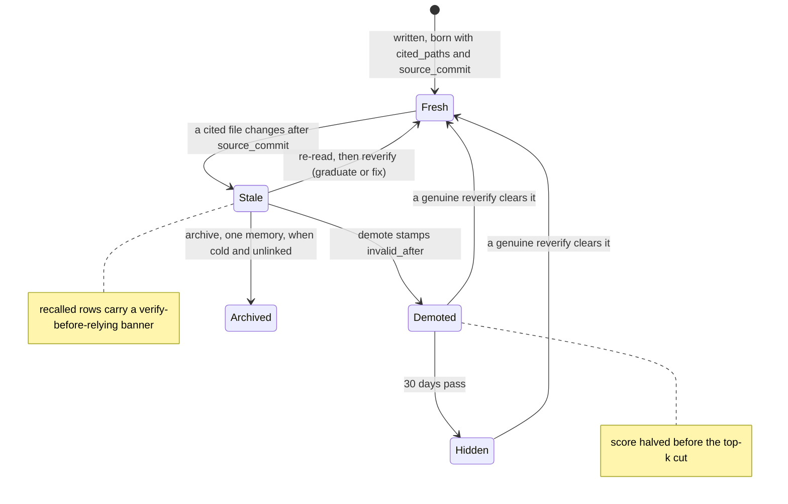

# The hippo memory engine

Local, no-server tooling over the markdown memory corpus at `.claude/memory/` in the
**consuming project**. It **activates** structure that already lives in the files
(citations, provenance, `[[wikilinks]]`, `description:` recall hooks) without changing the
contract that **markdown-in-git is the single source of authority** — everything else
(index, telemetry, graph caches) is derived, rebuildable, and gitignored.

This package ships inside the hippo Claude Code plugin (`plugin/memory/`, imported as
`memory`). The skills (`/hippo:setup`, `/hippo:new`, `/hippo:recall`, `/hippo:tend`,
`/hippo:doctor` and the rest) and the hooks (`plugin/hooks/`) are thin orchestration over the
CLI entry points documented here.

> [!NOTE]
> This is the engine reference. For what hippo is, how to install it and the commands, start
> at the [front README](../../README.md); for `hippo.json` and the gates, see
> [SETTINGS.md](../../SETTINGS.md).

<p align="center">
  <picture>
    <source media="(prefers-color-scheme: dark)" srcset="../../assets/readme/engine-map-dark.svg">
    
  </picture>
</p>

> [!IMPORTANT]
> **Four contracts every module keeps.** Markdown in git is the only authority: every derived
> file can be deleted and rebuilt. Hooks always exit 0 and never download. The per-prompt path
> runs no LLM and makes no network call. Corrective writes are per item and agent-gated: no
> module has a bulk verdict ([Appendix B](#appendix-b--why-there-is-no-bulk-re-baseline)).

| | Contents |
|---|---|
| **Recall** | [Hybrid recall](#hybrid-recall) · [Warm recall](#recall_warmpy--warm-recall-in-the-sessions-mcp-server) · [Retrieval profiles and Qwen3](#retrieval-profiles-and-the-qwen3-high-space) · [Merge gates](#eval_recallpy--the-5-merge-gates) |
| **Lifecycle** | [Staleness and provenance](#staleness--provenance) · [Reconsolidation](#reconsolidation-the-immune-system) · [Decay and archive](#graceful-decay--soft-invalidation--archive) · [Purge](#purging-a-memory-and-scrubbing-its-history) |
| **Structure** | [Wikilink graph](#wikilink-graph) · [Writing memories](#writing-memories) · [Corpus format versions](#corpus-format-versioning-the-doctor-driven-migration-path) |
| **Runtime** | [SessionStart dispatcher](#the-sessionstart-dispatcher) · [Telemetry](#telemetry-three-ledgers) · [Degraded modes](#degraded-modes-all-legible-none-fatal) · [LLM enrichment](#standalone-llm-enrichment-opt-in-default-off) |
| **Reference** | [Environment overrides](#environment-overrides) · [Tests](#tests-dev-checkout) · [Appendix A](#appendix-a--the-durable-model-cache-gotcha) · [Appendix B](#appendix-b--why-there-is-no-bulk-re-baseline) |

## Running the commands in this doc

Inside a Claude Code session (skills, agents), the plugin env vars are set. Every code
block below assumes this one-time shell setup:

```bash
PY="${CLAUDE_PLUGIN_DATA}/venv/bin/python"   # built by /hippo:setup
export PYTHONPATH="${CLAUDE_PLUGIN_ROOT}"    # so `import memory` resolves to this package
```

Every module below with a command line is also a `hippo <verb>` (SRF-1): `bin/hippo`
is the one entry the skills, hooks and printed hints use. It does the same resolution
internally, finds the installed venv when the shell has no plugin env, and falls back to
bare `python3` pre-bootstrap (BM25-only via the vendored fallbacks in
[`_vendor/`](_vendor/__init__.py)). `hippo help --all` prints the verb table
([`cli_verbs.py`](cli_verbs.py)); each verb runs its module exactly as `python -m` does.

In a **dev checkout of this repo**, use `PY=.venv/bin/python` and `PYTHONPATH=plugin`
instead.

## Hybrid recall

### `build_index.py` — offline hybrid index builder

Builds a gitignored, rebuildable index at `.hippo/index/` over each memory's
`name` + `description`:
- **dense** — `bge-small-en-v1.5` via `fastembed` (ONNX, no torch) on the default profile
  (the `high` profile builds a Qwen3 twin beside it, [below](#retrieval-profiles-and-the-qwen3-high-space)), and
- **sparse** — BM25 (`rank-bm25`, or the vendored scorer pre-bootstrap).

Incremental: unchanged memories reuse their cached embedding row (keyed by content hash);
only edited files re-embed. With `fastembed` absent/disabled it builds **BM25-only** (no
error). The index dir is self-ignoring (it drops a `.gitignore` containing `*` on first
creation) so it stays invisible to git even in projects that never patched `.gitignore`.

```bash
"$PY" -m memory.build_index --memory-dir .claude/memory --index-dir .hippo/index
```

**Auto-refresh at SessionStart:** you rarely run `build_index` by hand. The SessionStart
dispatcher calls `refresh_index()` on every start — incremental, **offline**, bounded,
**never-downgrade** — so a memory written during one session is indexed (recallable) by
the next. A fast no-op when nothing changed; if a cold cache can't embed offline it leaves
the last good index in place rather than degrade it to BM25. The model cache itself is
warmed ONCE, online, by `/hippo:setup` (a hook must never download — see
[Appendix A](#appendix-a--the-durable-model-cache-gotcha)).

### `recall.py` — query-time fused recall

`recall(query, k=10)` → top-K via **RRF fusion** of dense + BM25, **degrading to BM25**
when the dense model/cache is unavailable. Never raises; output bounded < 10K chars. The
dense path is **wall-clock bounded** (`HIPPO_DENSE_TIMEOUT`, default 5 s) so a cold or
wiped cache aborts to BM25 instead of blocking the hook.

```bash
"$PY" -m memory.recall "how do we keep the memo writer from timing out"
```

Wired at **UserPromptSubmit** via [`../hooks/memory_user_prompt.sh`](../hooks/memory_user_prompt.sh)
(registered in [`../hooks/hooks.json`](../hooks/hooks.json)) — injects the top-K as
`additionalContext`, **always exits 0** (exit 2 would erase the user's prompt), and forces
HF offline so it can never trigger a download.

`recall.main()` (the CLI/hook entry, never `recall()` itself) also applies **query
hygiene** (`clean_query` strips harness envelopes and skips near-empty/continuation
prompts before any model load) and **floor-dedup** (memories already always-loaded in the
`MEMORY.md` floor are dropped from per-prompt results, topping back up to `k`).

### Whether to inject, and how much

Two rules sit between the ranking and the prompt. Neither changes how anything ranks.

- **The corroboration gate** ([`recall_abstain.py`](recall_abstain.py), HOT-2) admits a
  prompt only when two independent lanes agree on a memory, or one is strong on its own: a
  best cosine of at least `strong`, a description sharing several of the prompt's terms, or a
  memory in the top 10 of both lanes with shared terms or a cosine of at least `support`.
  Otherwise recall abstains and the receipt names the closest miss.
  `HIPPO_DISABLE=abstain-gate` turns it off.
- **The count rule** ([`recall_count.py`](recall_count.py), HOT-8, prompt hook only) serves up
  to `k` rows when the best cosine clears the dense floor by at least `wide`, and otherwise at
  most five, each with evidence of its own (a cosine within `band` of the best, both lanes'
  top 10, or a description naming the subject). `HIPPO_SIGNAL_COUNT=0` turns it off.

Every threshold belongs to one embedding space and is calibrated per model, so an
uncalibrated model, a BM25-only index or a dense failure leaves both rules off. The numbers
for each space are in the [calibration table](#each-space-is-calibrated-on-its-own) below.

### `recall_warm.py` — warm recall in the session's MCP server

Opt-in (`hippo setup --warm --yes` adds one `mcp_tool` UserPromptSubmit hook to the user's
settings). The session's MCP server already holds the interpreter, the imports and the
model, so it answers the prompt with the same `hookSpecificOutput` the spawned hook prints;
the body is the spawned hook's own (`recall_hook.run_recall`), so the two cannot drift.

The command hook stays installed and decides. Both hooks fire in parallel and settle each
prompt through one `O_EXCL` claim file in `${CLAUDE_PLUGIN_DATA}/warm/`: `warm` only for a
live server on the hook's own plugin version that accepts and is not mid-serve, else `spawn`.
Whoever arrives second obeys, so exactly one path injects. A version or index-schema
mismatch, no usable index, a busy server, or a tripped breaker (one served call over
`SERVE_BUDGET_MS` = 1.5 s, or 4 s for the call that loads the model) all fall back to the
spawn path. A served call only reads: the index on disk, through a cache that reloads when
the manifest changes.

### Retrieval profiles and the Qwen3 `high` space

A machine's **retrieval profile** ([`retrieval_profile.py`](retrieval_profile.py), HCR-1)
says how much model recall spends: `floor` (BM25 only, the dense lane off by policy),
`lean` (the default, everything above), or `high`. It is one key in
`${CLAUDE_PLUGIN_DATA}/model.json` beside the embedding-model preset, resolved env
(`HIPPO_RETRIEVAL_PROFILE`) > preset > default, and an invalid value falls through and is
reported by doctor, never raised. The `high` offer is hardware-gated (arm64 macOS with at
least 64 GiB); the switch itself is the user's on any machine, because a machine that cannot
serve `high` serves `lean`.

<p align="center">
  <picture>
    <source media="(prefers-color-scheme: dark)" srcset="../../assets/readme/high-serving-dark.svg">
    
  </picture>
</p>

**The embedder** ([`embed_mlx.py`](embed_mlx.py), HCR-2). Qwen3-Embedding-4B (the 8B behind
`HIPPO_HIGH_EMBED_MODEL`) through MLX, as 8-bit mxfp8 conversions pinned to one revision each,
so the weights a build embedded with are the weights recall queries with. The model is
instruction-aware: a query is embedded as `Instruct: <QUERY_INSTRUCTION>\nQuery:<text>`, a
document bare, and the vector is the final token's hidden state. Right-padded batches are
exact for a causal model, so no attention mask is needed. All MLX work runs on one worker
thread per process, fed in small slices so a waiting query waits one slice. A space is
active only inside `using_space` (a ContextVar), and only the warm server's high half enters
one: the spawned hook, the CLI and SessionStart never see it.

**The twin index** ([`recall_warm_high.py`](recall_warm_high.py)). `<index>/high/` is a
complete index built by the same `build_index` inside the Qwen3 space; its manifest names the
space, the width and the pinned weights. The lean build never looks inside `high/` and the
high build never writes outside it. On the first warm call of a high-profile session, a
daemon thread loads the model (off the serving path) and keeps every tier's `high/` caught
up with its lean twin, offline and incrementally. Until the model is loaded and every tier's
high index holds exactly the lean index's entries, warm calls serve lean. A served call on
high swaps only the loaded index and enters the space; links, rules and sidecars are still
read from the lean dir.

**The reranker** ([`rerank_mlx.py`](rerank_mlx.py), HCR-4). Qwen3-Reranker-0.6B, scored as
the model card specifies: `P(yes)` from the final position's yes/no logits. It sits behind
the one rerank seam (`recall_rank._cross_encoder_rerank`, whose other backend is fastembed's
MiniLM cross-encoder) and is active in two places only:

| Surface | When | Pool | Bound |
|---|---|---|---|
| `/hippo:recall` and the MCP `recall` tool | always, on `high`, when the weights are on disk | top 30 fused hits, then cut to `k` | 15 s |
| Warm per-prompt recall | only with `HIPPO_RERANK=1`, once the reranker has loaded | the same pool `lean`'s hot-path rerank reads | 0.8 s, then the fused order stands |

`HIPPO_RERANK_TIMEOUT` overrides either bound. The 4B reranker stays pinned for the benches
only; recall never scores with it.

#### Each space is calibrated on its own

A cosine from one model means nothing in another's space, so every threshold is keyed by the
space id (a truncated `model@dim` width is a different space and is not covered: doctor warns
while `HIPPO_HIGH_EMBED_DIM` is set). Each Qwen3 value was measured on three corpora on
2026-11-25.

| | `lean`: bge-small-en-v1.5 | `high`: Qwen3-Embedding-4B | Qwen3-Embedding-8B |
|---|---|---|---|
| Width | 384 | 2,560 | 4,096 |
| Weights | about 130 MB, ONNX | 4.2 GB, mxfp8 | 7.8 GB, mxfp8 |
| Dense floor ([`recall_rank.py`](recall_rank.py)) | 0.60 | 0.42 | 0.40 |
| Gate `strong` / `support` ([`recall_abstain.py`](recall_abstain.py)) | 0.76 / 0.72 | 0.60 / 0.60 | 0.50 / 0.48 |
| Count rule `band` / `wide` ([`recall_count.py`](recall_count.py)) | 0.05 / 0.18 | 0.12 / 0.14 | 0.11 / 0.12 |

The instruction-aware space separates on-topic from off-topic far more cleanly than
bge-small: on the 4B every measured off-topic best cosine sat under 0.41 and every on-topic
best over 0.49, where bge-small's classes overlap on a live corpus. Each constant's comment
carries its method and the evidence file under [`planning/`](../../planning/README.md)
(`HCR-3.evidence`, `HCR-3.8b.evidence`, `HCR-3.count.evidence`,
`HCR-3.hook-gaps.evidence`). `hippo eval --floor-sweep` sweeps inside the high space on a
high-profile machine, and `/hippo:doctor`'s `high_space_calibration` line says whether the
active space is calibrated.

What the profiles buy, measured, is charted in the
[front README](../../README.md#what-high-buys-measured); run the same comparison on your own
corpus with `python -m bench.profile_ab` ([`bench/profile_ab.py`](../../bench/profile_ab.py)).

### `eval_recall.py` — the 5 merge gates

```bash
"$PY" -m memory.eval_recall
```

Gates: synthetic self-recall@10 ≥ 0.90, curated hard-set recall@10 ≥ 0.80, MRR@10 ≥ 0.60,
net token reduction > 0, recall p95 < 300 ms (warm). Two kinds of input are **skipped
honestly** rather than failed (reported as `➖ skipped`, excluded from the RESULT):

- **hard-set gates** when no fixture exists — resolution probes the project-local
  `.claude/memory/.audit-fixtures/` (written by `/hippo:doctor`'s content audit), then the engine repo's
  [`tests/fixtures/`](../../tests/fixtures/recall_hard_set.yaml), else skips;
- **token_reduction** when the corpus has no `MEMORY.full.md` pre-trim snapshot (every
  fresh install) — there is nothing to compare the trimmed floor against.

`cold_latency` (fresh subprocess per sample — the REAL per-prompt hook cost, ~10× the warm
p95) is always reported. Its gate, `cold_p95_ms` (PRF-2; gated at the p95 tail since PRF-5), is **opt-in** via `--gate-cold`
(threshold `GATE_COLD_P95_MS` = 1500 ms) — off by default so an ungated hermetic run never
reddens on a cold OS cache; CI's dense lane passes `--gate-cold` so a real cold-path
regression fails the build. Requested but serving BM25-only is also **skipped honestly**
(cold ≈ warm without a per-process model load to amortize). Report-only scorecard extras:
precision@k (graded, from `recall_relevance_set.yaml`), staleness half-life, per-session
token cost, and the reconsolidation graduation rate.

## Staleness + provenance

A memory's life after it is written, from the modules below and the
[reconsolidation](#reconsolidation-the-immune-system) and [decay](#graceful-decay--soft-invalidation--archive)
sections:



### `provenance.py` — citation provenance backfill

Extracts `path:line` code citations from each memory **body** and records them as
**additive** frontmatter (`cited_paths`, `source_commit`). The body is never modified;
re-running is a no-op; both frontmatter schemas (a `metadata:` block and flat top-level)
are handled.

```bash
"$PY" -m memory.provenance --dry-run    # preview
"$PY" -m memory.provenance              # apply
```

- `cited_paths` — repo-relative code files the memory talks about (a bare basename keeps
  only an UNambiguous `git ls-files` resolution; ambiguous basenames are dropped). A
  **directory-qualified** token that is not itself a tracked path resolves only to a file
  whose path ENDS WITH it (ORC-4) and whose basename is unique: `../views-kit.js` resolves
  by its tail, and `apps/api/routes/admin.py`
  — a file in another repo the memory is about — resolves to nothing rather than to this
  repo's only `admin.py`. The extractor, the `git ls-files` oracle, the one resolver and
  the one merge policy live in `provenance_citations.py` (re-exported by the façade).
- `cited_paths_exclude` (CUR-2) — an optional, **human-owned** list of repo paths that are
  NOT this memory's citations, however the body reads. Every derivation honours it
  (initial backfill, `--refresh`/`--refresh-one`, `--reverify`, the `rederive` preview and
  apply — one shared `derive_citations`), none ever writes it, and the COR-9 damage guard
  treats it as a key no writer owns. It is how a deliberate prune of a *derivable* path
  holds — without it the path returns as a `+ gains` on the next preview and the
  derivation stamp can never be earned — and the only fix for a generic basename
  (`plan.json`, `ci.yml`, `.env.example`) that is unique in this repo inside a memory
  plainly about another one. Held-out paths are reported (`ℹ excluded`, the worklist's
  `⊘ excludes`), never silent. Pack extraction strips it with the citations it prunes.
- `source_commit` — the file's own last-edit commit, else **HEAD** ("reflects code as of
  now") when the file has no commit history yet — memories are born staleness-tracked
  even in a dirty worktree. A residual empty baseline (pre-0.2.0 files, or a corpus
  seeded before its repo's first commit) is **healed to HEAD at SessionStart** once
  resolvable; healing can never silence a flag, because an empty baseline never flags.

### `staleness.py` — the git-drift signal

A memory is **stale** when any of its `cited_paths` changed *after* its `source_commit` —
git drift, not calendar age. Two git calls total regardless of corpus size, then pure
comparison. Never raises.

```bash
"$PY" -m memory.staleness
```

### Verify-at-use banner + reinforcement (RET-6)

A currently-stale memory's injected pointer line (`recall.format_results`) carries a
one-line banner — `anchored to <sha>; N cited files changed since — verify before
relying` — sourced entirely from `stale.json` (LIF-6's `SessionStart`-derived cache; an
absent/corrupt cache degrades to **no banners**, never a hard error, and never a git call
on the recall hot path). A fresh memory carries none. **Reinforcement needs no separate
step**: `--reverify` (or `reconsolidate.semantic_reverify`'s `graduate`/`fix` outcome)
already re-baselines `source_commit` to HEAD, so a reinforced memory simply drops out of
the *next* `SessionStart`'s `find_stale` scan — and thus `stale.json` — and the banner is
gone. The first time a memory is EVER reverified, `--reverify` also additively stamps a
write-once `last_verified` timestamp (never overwritten by a later reverify) —
supplementary audit provenance (`staleness.read_last_verified`), distinct from
`source_commit`/`source_commit_time`, which remains the signal that actually clears the
banner.

### Clearing a flag: `--reverify` / `--refresh-one`

```bash
"$PY" -m memory.provenance --reverify <name>      # clear ONE memory after re-verifying it
"$PY" -m memory.provenance --refresh-one <name>   # re-derive ONE memory's citations only
```

- `--reverify NAME` — the verification-gated way to CLEAR a staleness flag (which
  `--refresh` deliberately CANNOT): after the content is re-read and confirmed to match
  current code, it re-baselines `source_commit` to HEAD and re-opens the
  soft-invalidation window. Frontmatter-only, body byte-identical, refuses unparseable
  files, per-memory by design — see
  [Appendix B](#appendix-b--why-there-is-no-bulk-re-baseline).
- `--refresh-one NAME` — re-derives `cited_paths` for one memory (e.g. after hand-editing
  its body), `source_commit` untouched. The corpus-wide `--refresh` does the same for
  every already-backfilled memory.

A `metadata:` block may END in a nested mapping (hippo's own `edge_origin:` stamp is one):
every frontmatter writer inserts at the block's FIRST-level key indent and claims only
top-level / direct-`metadata:` keys (COR-24), so that shape round-trips through all of
them. `rederive` reports what it did rather than what it usually does (MIG-2): the
baseline sentence distinguishes *preserved* from *assigned* (a memory that had no
`source_commit` has nothing to preserve), a `gained:`/`lost:` line is computed at call time
against the stored frontmatter so an index that moved since the worklist read is loud, and
a file with no `---` block is reported as **no frontmatter**, not as a YAML error.

### Volatile paths (VOL-1) — churn-by-design files stop arming the worklist

Some cited files change on nearly every session **by design** — a living roadmap, an
audience matrix, a migration runner, `package.json`. Memories cite them because their
bodies *delegate* to them ("live status lives there, not here"), so the citation is right
for recall and wrong as a staleness-**arming** trigger: whole-file drift there carries
~zero bits about memory validity, and un-citing would both break recall surfaces and be
undone by the next re-derivation. VOL-1 splits the two concerns at the corpus level.
Declare the churn files once, in the committed corpus marker:

```json
{"corpus_format": 5, "cite_derivation": 4,
 "volatile_paths": ["GROWTH-LOOP-ROADMAP.yaml", "docs/audience-matrix.yaml"]}
```
*(in `.claude/memory/.format`)*

Entries are toplevel-relative repo paths, matched **exactly** against `cited_paths`
(no globs); the key is hand-edited and committed — there is deliberately no writer, and
the version-stamp writers preserve it (merge-not-clobber). Semantics
(`staleness_policy.py`, read via `provenance.read_volatile_paths`):

- **Derivation unchanged** — the extractor still derives these paths into `cited_paths`;
  `rederive` output is byte-identical with or without the registry.
- **Recall unchanged** — JIT point-of-action recall, `recall --for-diff`, the RET-6
  verify-at-use banner, RET-5's ranking penalty, and `find_stale`/`stale.json` detection
  all keep consuming the citation exactly as before.
- **Arming changed** — a memory whose **only** drifted cited paths are volatile never
  enters the reconsolidation worklist and never gets a `[since-watermark]` flag; one
  non-volatile drifted path arms it exactly as today (full path listing kept). CLB-3
  quoted-evidence drift arms regardless — a memory's own quoted span changing is
  span-level truth even inside a volatile file.
- **Never silent** — the SessionStart staleness note, the `reconsolidate` CLI listing,
  and the consolidate MCP worklist each print what policy suppressed
  (`(+N … policy-suppressed; see .format volatile_paths)`), and doctor carries one
  always-`ok` line (`volatile paths: N declared; M … suppressed`). Deep-judgment
  surfaces (audit's stale section, archive's admission leg, publish's preflight) stay
  registry-blind — they exist to see everything.

Absent/empty key ⇒ byte-identical behavior (ED-4); every verdict stays human, per-item —
this routes detection only (ED-1). Tier-2 co-drift arming (volatile drift counting when a
non-volatile sibling also drifted) is a deliberate non-feature for now.

### Evidence anchors (TND-3) — report-only

A derived anchor is a token the memory writes as code (inside backticks) that also occurs
in a drifted cited file at the memory's `source_commit`. The path is *intact* when it has
an anchor, no line the `source_commit..HEAD` change added or removed contains one (a line
that only moved does not count), and every anchor still occurs at HEAD; a deleted,
renamed, binary, oversized, baseline-absent or anchorless path is never intact. A memory
is *quiet* when every drifted cited path is intact (`staleness_anchors.py`, derivation
version `ANCHOR_DERIVATION_VERSION`). Nothing is written anywhere: blobs come from one
`git cat-file --batch` call per batch.

Quiet does **not** change arming in this release: a replay over the real historical
verdicts did not reach the gate (at least half of graduates quiet with at most 5% of
fix/demote verdicts suppressed), so doctor counts how many armed stale memories *would*
be quiet and `hippo staleness --anchors` lists each with its anchors and the change
lines that touched them. `HIPPO_QUIET_ARMING=0` turns the anchor report off.

### Citation binding in the index (FMT-2) — derived beside frontmatter

Every index build and SessionStart refresh derives each memory's citation binding from its
body with the current extractor: `cited_paths` (minus the memory's own authored
`cited_paths_exclude`), the body tokens nothing could pin, and the evidence-anchor
candidates. It lives in a sidecar beside the index (`citation_binding.json`, not in
`manifest.json`, which the prompt hook loads every prompt), keyed by memory name with the
hash of the text it came from, stamped with the citation and anchor derivation versions and
a fingerprint of the repo file list (one `git ls-files` per build). A memory re-derives only
when its text or the file list changed; a missing, torn or older-version sidecar reads as
absent. `source_commit`, `cited_paths_exclude` and relations stay authored in frontmatter.

Readers prefer it (dual mode): staleness, the SessionStart relevant-to-work line, the
re-verify watermark, the JIT touch map, `recall --for-diff` and the outcome join use a
memory's derived `cited_paths` when the sidecar is current and its row was derived from
the memory's exact text, else its frontmatter `cited_paths`. Writers are unchanged:
`new_memory`, reverify and rederive still write frontmatter. The tend `derivation` kind and
the SessionStart citation-derivation note stop listing a memory whose index binding is
current (doctor says so instead of asking for a re-derivation); the explicit rederive verb
and its stamp still compare frontmatter. The review packet renders each touched memory's
derived citations beside its frontmatter. Doctor reports the sidecar's state and how many
memories' frontmatter differs from it; `hippo migrate --check` reports how many bindings the
index already derives. `HIPPO_INDEX_BINDING=0` is frontmatter only, exactly as before.
Citation rot, packs, exports and promoted rules deliberately keep reading frontmatter: they
report on, or copy out, the committed field itself.

### Citation rot (LIF-3) — a vanished cited path is loud, never a silent shrink

A renamed/deleted cited file used to vanish from `cited_paths` on the next re-derivation
— possibly to `[]`, after which the memory is permanently exempt from staleness with no
record anything was lost. Two surfaces close that hole:

- **The drop itself**: `backfill_file(refresh=True)` / `reverify_file` results carry
  `dropped_citations` (paths in the frontmatter BEFORE the re-derivation, absent AFTER).
  The provenance CLI (`--refresh` / `--refresh-one` / `--reverify`) and
  `reconsolidate --reverify` print one shared per-file rot line
  (`provenance.citation_rot_lines`) whenever it is non-empty; a drop to **zero** is
  called out distinctly — the memory becomes staleness-EXEMPT.
- **Current state, before any drop**: `staleness.find_citation_rot(memory_dir, repo_root)`
  lists memories whose frontmatter cites paths no longer in the repo file index
  (`find_unparseable`'s rot sibling; `[]` when the index is unavailable — under-flag
  beats cry-wolf in a non-git dir). Surfaced count-first by the SessionStart
  `citation_rot` producer and in `python -m memory.staleness`'s default report, next to
  the unparseable block; TOTAL rot (every citation gone) is marked on its line.

### The pre-migration backup: `--snapshot` (MIG-6, MIG-7, MIG-12)

```bash
"$PY" -m memory.provenance --snapshot <label>   # before the first re-derivation write
```

The backup is whatever git cannot already undo (`provenance_snapshot.take_snapshot`). When
every memory file and `.format` is tracked and `git status` shows nothing under the corpus,
nothing is copied: the result names HEAD and the `git -C <corpus> checkout <sha> -- .` that
restores it. Otherwise (a gitignored corpus, an uncommitted edit, a new or ignored memory) the
corpus is copied to `<project>/.hippo/snapshots/memory.pre-cite2-<label>/`, and the result
prints the `cp -Rp` that copies it back. That dir sits beside `.claude/`, not inside it,
because the Claude desktop app copies `.claude/` (ignored files included) into every worktree it
creates, and it shares the `.hippo/` container with the derived dirs, so a project has one hippo
dir. It ignores itself: its `*` .gitignore lands before the copy, and a marker that no
longer ignores everything refuses the copy. The copy holds no marker of its own, so it is
byte-identical to the corpus. Backups taken before v1.42.3 sit in `.claude/memory.pre-cite*/`;
doctor's `snapshots` line names them with their size, and calls them spent once the citation
derivation is stamped and the re-derivation worklist is empty (MIG-8). The same line counts
the backups in `.hippo/snapshots/` and v1.42.3's `.hippo-snapshots/`, and the copies the
desktop app's worktrees carry in `.claude/worktrees/*/.claude/` (MIG-16).

## Reconsolidation (the immune system)

### `reconsolidate.py`

`recalled_stale_worklist(...)` intersects recently-recalled names (the recall ledger,
last N sessions) with the stale set — memories actively shaping behavior whose cited code
drifted. Read-only CLI + the `reconsolidation` producer (silent unless non-empty).

When the link graph is buildable (`links.build_graph`, cache-aware), each item also
carries a `linked` column (GRA-9): up to 3 one-hop neighbors — inbound + outbound
`[[wikilinks]]` unioned with typed edges, minus names already on the worklist — rendered
as `X (+2 linked: Y, Z)`. Review-adjacent and **report-only** (zero write paths): when a
memory drifts, its neighbors are the next most likely to be wrong. No graph → no column;
the worklist is exactly its pre-GRA-9 self.

LIF-1 closes the re-nag loop — the worklist is **actionable-only**: items whose file
already carries `invalid_after` (demote's terminal state) are excluded (the staleness
producer still counts them), and `--snooze <name>` records an explicit per-item ack in
the reconsolidation ledger that silences an item for the next 5 new sessions, then
expires (a deferral, not a verdict — only demote is terminal).

```bash
"$PY" -m memory.reconsolidate
"$PY" -m memory.reconsolidate --snooze <name>    # ack: skip for 5 sessions, then re-nag
```

`semantic_reverify(name, outcome, ...)` is the per-item write primitive — `graduate` /
`fix` route through `reverify_file` (clears the flag), **`demote` does NOT** (a
confirmed-wrong memory must stay visible to staleness) — instead it **chains
`set_invalid_after`** onto the memory and refreshes the index (LIF-1), so recall's
pre-cut penalty demotes it immediately: one command, no separate `--invalidate`.
Verdicts land in the reconsolidation ledger (demote events carry `invalidated` for
audit); `eval_recall.graduation_rate()` reports `graduate / (graduate + demote)` (fixes
and snoozes excluded by design). No bulk variant exists.

`superseded_by=<successor>` (GRA-4, `demote` only, opt-in): when the agent knows
WHICH memory replaces the demoted one's claim, this appends `supersedes: [name]` to the
**successor's** frontmatter (via `links.add_typed_relation` — additive, body-preserving)
AND stamps the loser's `invalid_after` at the **successor's commit date** (GRW-7 — the
succession moment becomes an explicit, auditable validity boundary; an uncommitted
successor falls back to now-UTC), so recall demotes the loser below its successor and
annotates it. Per-item and agent-gated like everything else here; refused for `graduate`
AND `fix` (both assert the memory is CURRENT, which contradicts naming a successor) and
when either memory is missing. CLI: `"$PY" -m memory.reconsolidate --reverify <name>
--outcome demote --superseded-by <successor>`.

## Graceful decay — soft-invalidation + archive

Decay is DEMOTION, never deletion.

- `staleness.set_invalid_after(name)` stamps an additive `invalid_after` frontmatter
  timestamp: **< 30 days old** → still recallable, fused score halved BEFORE the top-k
  cut (real demotion — it can fall out of top-k); **≥ 30 days** → dropped from recall
  display only, still in corpus/index; **cleared** by a genuine `--reverify`. A `demote`
  verdict chains this automatically (LIF-1) — the manual `--invalidate` remains for
  judging a memory questionable *without* rendering a reconsolidation verdict.
- `archive.py` — `archive_candidates` reports the intersection of four gates (cold ∧
  stale ∧ zero-inbound ∧ not-cited-by-instructions, the last failing CLOSED on read
  errors). LIF-4: the report enforces its own trust threshold — until the ≥5-session
  soak bar is met it returns `[]` with a machine-readable reason
  (`diagnostics["reason"] = "soak_gate_unmet"`) instead of a maximally-permissive
  fresh-install list, and would-be candidates younger than the soak window (per git
  first-seen, not yet exposed to 5 distinct sessions) are excluded and named in the
  report; `--archive <name>` is a per-item, git-reversible `git mv` into
  `.claude/memory/archive/` (a tracked subdir the corpus iterator skips). Never fires
  automatically; no `--all` exists. GRA-5: the move REFUSES — machine-readable
  `refused: True` + the `referrers` list in the result, zero filesystem change — while
  OTHER memories still reference the target (untyped `[[wikilinks]]` unioned with GRA-4
  typed inbound edges, via the one canonical `LinkGraph.inbound()`/`typed_inbound()`
  API), unless `--force`; every successful move also reports the referrers so the caller
  rewrites those links in the same commit (a `supersedes:` edge on the successor memory
  is the machine-readable forwarding pointer).

```bash
"$PY" -m memory.staleness --invalidate <name>
"$PY" -m memory.archive                             # report only
"$PY" -m memory.archive --archive <name>            # per-item move; refuses while inbound links exist
"$PY" -m memory.archive --archive <name> --force    # move anyway; referrers printed for same-commit rewrite
```

## Purging a memory (and scrubbing its history)

> [!CAUTION]
> Purge rewrites git history and cannot be undone. Every collaborator re-clones afterwards,
> and a leaked credential is rotated whether or not the purge succeeds.

Archive is the *reversible* end of the decay spectrum — a tracked `git mv` you can undo. **Purge
is the irreversible end**: excise ONE memory and every trace of it while keeping the rest of the
corpus. Reach for it when a memory was created in error, contains a leaked secret (the SEC-2
write-time/doctor warning points here), or must be forgotten for privacy. It is distinct from:

- **`/hippo:archive`** — demotes a memory to `.claude/memory/archive/`; the content stays in git
  history. Not a purge.
- **`/hippo:remove`** — whole-project offboarding; it deletes the symlink and the derived caches
  but **refuses to touch `.claude/memory/` files**. Not a purge.

There is no bulk/automated purge command by design (the per-item agent-gate is permanent). Follow
these steps for the one memory `<name>` in corpus `<memory_dir>` (its index dir is
`<index_dir>` — the gitignored `.hippo/index`, or a tier's own index):

1. **Remove the memory file** and drop its floor pointer.
   ```bash
   git rm "<memory_dir>/<name>.md"
   # then delete the "- [...](<name>.md) — ..." line from <memory_dir>/MEMORY.md, if any
   ```
   (For a user/private-tier memory the file and its pointer live in that tier's own dir, e.g.
   `~/.claude/hippo-memory/` or `.claude/memory.local/` — purge there instead.)

2. **Scrub it from git history.** A `git rm` only removes it going forward; every prior commit
   still carries the content, and any clone or fork keeps it. Rewrite history with
   [`git filter-repo`](https://github.com/newren/git-filter-repo) (safer than `filter-branch`):
   ```bash
   git filter-repo --path ".claude/memory/<name>.md" --invert-paths --force
   ```
   This **rewrites every commit** and changes SHAs — coordinate with collaborators and force-push
   (`git push --force-with-lease`), then have everyone re-clone. **If the memory held a real
   secret, rotate the credential regardless** — assume any pushed history was already cloned.

3. **Clear the index rows.** The dense/BM25 index embeds the memory's description *and body
   chunks*, so its text survives in `manifest.json` and its vectors in the `dense.<id>.npy`
   matrices until a rebuild. Rebuild it:
   ```bash
   "$PY" -m memory.build_index --memory-dir "<memory_dir>" --index-dir "<index_dir>"
   ```
   (SessionStart rebuilds automatically too, but run it now to verify immediately. `--force`
   re-embeds every memory from scratch.) A build keeps the matrices it supersedes for five
   minutes, for readers still holding the previous manifest, and the first build after that
   deletes them. To drop them now, delete every `dense.*.npy` in the index dir except the one
   `manifest.json` names as `dense_file`.

4. **Clear the ledgers.** The telemetry ledgers store recalled memory **names** and truncated
   query previews (never bodies) in `.hippo/telemetry/`. To erase a purged name, delete
   or rotate that dir (all derived, rebuildable): `rm -rf .hippo/telemetry`. If the name
   was published in a committed per-user usage summary (TEA-5), also edit or `git rm`
   `.claude/memory/.usage/<user>.json` and scrub it from history via step 2.

5. **Clear the pre-migration backups.** Before a citation re-derivation rewrites frontmatter,
   the snapshot copies the whole corpus (before v1.42.3 every time; since then only when git
   cannot restore it, as *The pre-migration backup* above describes). Each copy carries its own
   `<name>.md`, a leaked secret included, and its own `MEMORY.md` with the memory's floor
   pointer, if it had one. The copies are gitignored, so step 2 never reaches them, and hippo
   never deletes one by itself. They live in three places:
   - `<project>/.hippo/snapshots/memory.pre-cite2-*/`: v1.42.5 and later.
   - `<project>/.hippo-snapshots/`: v1.42.3 and v1.42.4.
   - `.claude/memory.pre-cite*/`: older. The Claude desktop app copies `.claude/` into every
     worktree it creates, so each worktree made after one was taken holds its own copy in
     `.claude/worktrees/*/.claude/`.

   `/hippo:doctor`'s `snapshots` line counts them in all three places, worktree copies
   included, with their size. To list the ones that hold `<name>.md`, run this `find` from the
   project root:
   ```bash
   find .hippo/snapshots .hippo-snapshots .claude -path '*/memory.pre-cite*/*' -name "<name>.md" 2>/dev/null
   ```
   For each backup it names, delete `<name>.md` and any pointer line in that backup's
   `MEMORY.md`, or, once the backup is spent, delete the backup outright:
   `rm -r "<backup dir>"`. A backup is spent once the citation derivation is stamped and the
   re-derivation worklist is empty, which doctor reports for the ones in `.claude/`. Until then
   it is the migration's undo, so edit it instead. Since v1.42.3 a committed, clean corpus gets
   a git restore point instead of a copy (MIG-7), and step 2 already scrubs that.

6. **Verify nothing surfaces.** Confirm the memory is gone from the corpus, the backups, the
   index, and recall:
   ```bash
   grep -ri "<distinctive phrase from the memory>" .claude/memory        # -> no hits
   find .hippo/snapshots .hippo-snapshots .claude -path '*/memory.pre-cite*/*' -name '*.md' \
     -exec grep -li "<distinctive phrase from the memory>" {} + 2>/dev/null   # -> no hits
   "$PY" -m memory.recall "<the memory's own topic>"                      # -> does not list <name>
   ```
   Following these steps leaves no trace in the corpus, backups, index, ledgers, or recall output.
   `/hippo:doctor`'s secret check references this procedure in its remediation line.

## Wikilink graph

### `links.py` / `lint_links.py`

`build_graph(memory_dir)` parses `[[name]]` markers into adjacency, slug-normalizing so
`_`/`-` variants and dropped category prefixes resolve. Every node is a filename **stem**
(`foo`, never `foo.md`), the same identity staleness/soak/archive key by — graph output
joins against their name sets with no conversion. `traverse(name, hops)` walks N outbound
hops; `inbound(name)` answers "what refers to this memory?" from a reverse adjacency built
once at construction (the codebase's single adjacency inversion); `orphans()` is
zero-OUTBOUND (may still be well-cited), `isolates()` is zero-in AND zero-out (genuinely
disconnected). Soft aliases (prefix-strip / `name:` slug) claimed by two or more files
are **ambiguous** — `resolve()` refuses them rather than guess (a full-stem claim still
beats any soft claim). `lint_links` flags **dangling** targets, **ambiguous** targets
(naming every claimant), **slug-mismatches**, **dangling typed relation targets**, and
**orphans** — read-only, never edits a memory; its one-line summary is the `link_health`
producer.

**Deliberate forward references (GRF-6).** A source may declare `planned: [name]` in
frontmatter (top-level or under `metadata:`; bare string tolerated) — a dangling wikilink
matching a declaration on its OWN source reclassifies to the informational `planned` class:
silent at SessionStart and out of doctor's rot count (noted, never counted), still listed
by the CLI and `memory.links --audit`. Declarations round-trip through `links.json`
(since schema v5), so the cached producer path stays zero-read. Archived, superseded, and
cross-tier targets are never maskable; `--audit` flags a declaration whose target now
exists as a stale planned marker.

**Folded memories (GRF-7).** A corpus whose fold ritual moves an idle memory into a digest
and deletes the file declares its digests once, in the committed marker:

```json
{"corpus_format": 5, "fold_digests": ["folded-*.md", "live-lanes-*.md"]}
```
*(in `.claude/memory/.format`; `fnmatch` globs over memory filenames, read via
`provenance.read_fold_digests`; no writer — operator-committed policy like `volatile_paths`)*

A dangling wikilink whose target survives in a declared digest — as a `### <slug>` heading
(family digests) or a `- [<slug>](…)` list row (day files; the href is free) — reclassifies
to the informational `folded` class, each entry naming its digest: silent at SessionStart,
out of doctor's rot count (noted, never counted), listed by `memory.lint_links` and
`memory.links --audit` as `src -> target (in <digest>)`. It is a classification, never an
edge: adjacency, `links.json`'s edge lists and recall's 1-hop expansion are identical with
or without the declaration, so a digest never becomes a hub. Archived targets are never
maskable (GRF-6's rule); typed relations into a folded slug stay `typed_dangling`; the
`--boundary` view stays fold-blind. The fold surface rides `links.json` (schema v6) beside
the declaration it was read under — the cached producer path stays zero memory-file reads,
and an edited declaration reads as a cache miss. Undeclared ⇒ byte-identical behavior.

**Typed edges (GRA-4, corpus format 2).** Frontmatter may declare
`supersedes: [name]`, `contradicts: [name]`, `refines: [name]` (each a list of memory
names/stems, top-level or under `metadata:` — the `cited_paths` read convention);
`[[wikilinks]]` remain the untyped edge. Targets resolve through the SAME alias tiers as
wikilinks. Consequences at recall time (served from the persisted `links.json`, zero
corpus re-reads; cache absent → no effect): the TARGET of a live `supersedes` edge has
its fused score halved BEFORE the top-k cut (its successor outranks it; wide-k still
surfaces it) and its pointer carries `[superseded by <name>]`; a `contradicts` target is
NOT demoted — it carries `[contradicts <name> — verify]` only; `refines` is navigational
(no ranking effect, no annotation). The one write primitive is
`links.add_typed_relation(path, relation, target)` — additive, body-preserving,
idempotent, per-item; reconsolidation's `superseded_by` opt-in routes through it.

```bash
"$PY" -m memory.links --traverse <name> --hops 2
"$PY" -m memory.lint_links
```

## Writing memories

### `new_memory.py` — recall-ready creation

```bash
"$PY" -m memory.new_memory my_slug "one-line recall hook" --type project --body "the WHY"
```

Writes the frontmatter the system depends on (`name`, `description` — **the recall
hook** — and `metadata.type`), backfills provenance (born staleness-tracked), refreshes
the index (**immediately recallable**), and inserts a `MEMORY.md` floor pointer **only
for `user`/`feedback`** types — at its deterministic **sorted** position within the
section (lexicographic by memory name) rather than always at the section tail, so two
teammates adding different pointers to the same section land on different lines and
merge cleanly instead of colliding on the shared tail line (TEA-4). Never overwrites an
existing file. Prefer the `/hippo:new` skill, which wraps this with the
what-not-to-save judgment.

### `lint_floor.py` — the floor invariant

The `MEMORY.md` floor is the only always-loaded memory context, so it stays lean: memory
pointers belong ONLY under `## User` and `## Working Style & Process Feedback` (or the
sections the corpus declares in `hippo.json` `floor_sections` — see CONVENTIONS.md);
`project`/`reference` memories are recalled on demand. `lint_floor` flags re-bloat and
floor link rot (read-only); its summary is the `floor` producer.

```bash
"$PY" -m memory.lint_floor
```

### `gate.py` / `gate_hook.py` — the write gate

Wired at **PreToolUse** (matcher `Write|Edit|MultiEdit`) via
[`../hooks/memory_pre_tool.sh`](../hooks/memory_pre_tool.sh). The bash fast path rejects any
write whose `file_path` is not a `.md` file directly in a `memory` directory before an
interpreter starts. For a corpus write, `gate_hook` simulates the tool (Write content; Edit
`old_string` -> `new_string`, `replace_all`; MultiEdit in order) and `gate.judge_file` compares
before and after with `lint_floor.measure_floor`'s definitions: floor bytes and lines against
the warn lines, `max_line`, `banned_re`, `section_budgets`, and `banned_re` over memory bodies.
A finding needs the after side over budget **and** worse than before. The default is a warning
in `additionalContext`; `permissionDecision: "deny"` only when the committed `hippo.json` at
HEAD and this machine's accepted value (`policy_consent.honoured`) both say
`"gate": {"write": "deny"}`. `"off"` silences it. Always exits 0.

`gate_cli.py` is `hippo gate`: the same `judge_floor` (never `judge_body`: bodies are a
write-time warning only, and the commit path reads no memory body) over HEAD -> index
(`--staged`) or first parent -> commit (`--commit <rev>`), trees read by `ls-tree` /
`ls-files -s` / `cat-file --batch`, plus the declared `budgets` (`files`, `floor_bytes`,
`floor_lines`, `journals`). Exit 0 / 1 (a budget got worse) / 2 (usage). `--install [--yes]`
writes a marker-carrying pre-commit hook that runs `--staged`.

## Corpus format versioning (the doctor-driven migration path)

Two version numbers, two very different contracts (COR-7):

- **Index** — `manifest.json` carries `schema_version` (`build_index.SCHEMA_VERSION`).
  The index is a derived cache, so a mismatch (any plugin update that changes the manifest
  shape) is **self-healing and needs zero operator action**: every load path treats a
  mismatched manifest as absent, and the next SessionStart refresh performs one full
  rebuild stamped with the current version.
- **Corpus** — `.claude/memory/.format` declares `{"corpus_format": N}`
  (`provenance.CORPUS_FORMAT_VERSION`, currently **5**). It is committed **with** the
  corpus (it describes the corpus; it is not a rebuildable cache); `/hippo:setup` stamps it
  when seeding a fresh corpus, and **a corpus with no marker reads as format 1** — every
  pre-marker corpus is already on the baseline, nothing to backfill. The marker also
  carries the corpus's other committed axes — `cite_derivation` (DRV-2) and the
  `volatile_paths` arming policy (VOL-1, see the staleness section) — all additive keys;
  every reader pulls only its own, so older plugins ignore the ones they don't know.

  Format history (every bump so far is purely ADDITIVE):

  | Format | Item | Frontmatter may carry |
  |---|---|---|
  | v1 | | the pre-versioning baseline |
  | v2 | GRA-4 | typed relations: `supersedes:`, `contradicts:`, `refines:` lists |
  | v3 | GOV-2 | `steer: pin`, the author's bounded, always-on recall lift (an unknown `steer` value reads as unsteered, fail-open; MUTE stays gated on the salience keystone) |
  | v4 | GOV-7 | `confidence: draft\|verified\|authoritative`, rendered at inject and in `/hippo:recall`; load-bearing in ranking since DRM-6 (draft ×0.5 and the draft-only abstention guard; absence reads as the neutral default) |
  | v5 | DRM-6 | `derives-from:`, the derivation-provenance typed relation (a generated schema names the children it was abstracted from; hand-authored derivations welcome) |

  Each migration is therefore the trivial case of the flow below: no per-memory edits are
  required. Review that no existing frontmatter uses the new key(s) for something else, then
  stamp the marker (`write_corpus_format`). Until stamped, an older corpus is read
  identically; the conventions any teammate authors still work (formats are additive where
  possible), and the marker just records which conventions the corpus has adopted.

**How a corpus format bump is detected, and what the operator does.** The corpus is the
git-tracked source of authority, so hippo **never migrates it autonomously** — detection
is loud, the fix is operator-driven:

1. *Corpus newer than the plugin* (a teammate on newer hippo bumped the format): the
   `corpus_format` SessionStart producer warns every session, and `/hippo:doctor`'s
   format check names both versions → **update the hippo plugin**. Nothing else to do.
2. *Corpus older than the plugin* (a plugin update shipped a format bump): `/hippo:doctor`
   names both versions and points here. The release notes of the version that bumped
   `CORPUS_FORMAT_VERSION` carry the migration steps; the operator runs them from doctor —
   per-item, agent-gated frontmatter/body edits (the audit pattern: review each change,
   no bulk sweep) — then stamps the marker as the final, explicit step
   (`memory.provenance.write_corpus_format`). Until migrated, the plugin keeps reading
   the old format (formats are additive where possible); newer-format features stay off.

## The SessionStart dispatcher

### `session_start.py`

ONE process, ONE corpus load, ONE merged `additionalContext`. Producers, in order:
`stale_venv` (deps changed since bootstrap → re-bootstrap nudge), `integrity`
(unparseable frontmatter — surfaced FIRST among corpus signals so a malformed memory
can't hide), `citation_rot` (cited paths gone from the repo, LIF-3), `staleness`,
`reconsolidation` (recall-filtered staleness worklist),
`git_recent`, `link_health`, `floor`. Self-suppresses when no producer has anything to
say; bounds output under the harness's 10,000-char cap; **always exits 0**. Side effects
(not producers): heal empty baselines, `refresh_index()`, `mark_session()`.

LIF-1: the `staleness` producer suppresses the per-item lines of entries already
carrying `invalid_after` (demote's terminal state — recall is already ranking them
down) but keeps them **counted** in a `(+N already demoted)` tail, so suppression is
never silent disappearance; once an invalidation ages past recall's 30-day old horizon,
the same block names it and suggests the archive flow of `/hippo:doctor`'s content audit (report-only).
VOL-1 extends the same discipline to volatile-path policy suppression: items whose only
drift is a registry-listed churn file get no per-item line and no worklist entry, but
the note always renders the count (`(+N … policy-suppressed; see .format
volatile_paths)` — or one calm ℹ line when *everything* stale is policy-suppressed).

Wired via [`../hooks/memory_session_start.sh`](../hooks/memory_session_start.sh), which
also owns the **first-run nudge**, emitted before Python is even involved. Venv/sentinel
missing → "run /hippo:setup": a machine-level line, shown in the first session of each day
(a day stamp in plugin data) and dismissed machine-wide. A corpus-less repo nested inside
another corpus → "run /hippo:setup here, or pin HIPPO_CORPUS_ROOT to share it"; an opted-in
repo with no corpus → "run /hippo:setup here": per-repo lines, shown every session and
dismissed per repo.

## Telemetry (three ledgers)

`telemetry.py` writes append-only, size-bounded (rotating), gitignored JSONL ledgers under
`.hippo/telemetry/` — derived local history, never authority:

| Ledger | Written by | Content |
|---|---|---|
| `recall_events.jsonl` | `recall.main()` after results | `{ts, session_id, names, backend, latency_ms, k, query_preview}` |
| `episode_buffer.jsonl` | `recall.main()`, same block | adds the repo HEAD watermark — replayed by the CAP-2 SessionEnd capture pass (`memory.capture`) into the gitignored `.hippo/pending/` queue |
| `reconsolidation_events.jsonl` | `record_reconsolidation_outcome()` | `{ts, name, outcome[, invalidated]}` verdicts + LIF-1 snooze acks |

Contract: never raises, never delays a recall (fires after results, fully wrapped), no
sensitive content (an 80-char query preview, never the full prompt). **Hygiene:** a
project with no `.claude/memory` corpus gets NO ledgers at all, and the telemetry dir is
self-ignoring (a `.gitignore` containing `*` inside it) so `git add .` can never commit
prompt previews.

Beside the ledgers sits `usage_aggregates.json` (LIF-4) — a tiny per-memory summary
(first/last recalled ts, distinct-session count) folded in on every recall append and
**never rotated**, so the byte-capped ledger can drop its oldest tail without a
long-lived corpus losing its oldest usage evidence. `read_usage_aggregates()` is the
read surface; the soak/curation/archive analyzers union it with the ledger.

### `soak.py` — soak status + curation report (read-only)

Distinct-session count vs the **≥5-session** curation-soak bar, per-memory recall hits,
the never-recalled set (dead-weight candidates — clone-local, topic-biased; read with
care), and the BM25-fallback rate. Session counts and the never-recalled set union the
rotation-surviving `usage_aggregates.json` with the retained ledger (LIF-4); raw hit
counts stay ledger-window-only. `compute_strength_scores()` returns
`{name: distinct_sessions_recalled / total_sessions}` — sessions, not events, so one
chatty session can't inflate a memory's strength.

**TEA-5 — usage signals are honest about their scope.** The ledger and aggregates are both
clone-local, so "never recalled" means "never in **this** clone" — a memory a teammate hits
daily reads as dead weight on your machine. The report **labels the signal's scope**
(clone-local vs cross-clone) on every run. To make coldness team-wide, each teammate runs

```bash
"$PY" -m memory.soak --record-usage      # folds this clone's usage into .usage/<user>.json
```

and commits `.claude/memory/.usage/`. That directory is an **append-only, committed** (not
gitignored) per-user summary — memory names + counts + timestamps only, **no session ids** — that
`soak.curation_report` / `soak_status` union before judging coldness. It is never indexed,
recalled, or floor-scanned (a `.usage` subdir of `.md`-only membership). A plain

```bash
"$PY" -m memory.soak
```

still reports without writing anything.

## Degraded modes (all legible, none fatal)

| State | Behavior |
|---|---|
| No bootstrap (bare `python3`) | BM25-only recall via [`_vendor/`](_vendor/__init__.py) (score-identical scorer + frontmatter-subset parser); SessionStart nudges `/hippo:setup` |
| Model cache cold/wiped | Dense aborts within the wall-clock bound → BM25; the index never downgrades; `/hippo:doctor` flags the cache |
| Deps changed after update | The `stale_venv` producer nudges a re-bootstrap once per session |
| No `.claude/memory` corpus | Hooks stay inert: no index, no ledgers, zero files created; SessionStart nudges `/hippo:setup` |
| Untrusted corpus (SEC-1) | A cloned/foreign git corpus injects NOTHING until trusted: recall returns `[]`, producers stay silent; a low-frequency SessionStart nudge points at `/hippo:doctor` (count + sample names → one-time consent). `/hippo:setup` trusts corpora you create; `HIPPO_TRUST_ALL=1` bypasses for CI |
| `high` profile cannot serve | Not Apple Silicon, MLX absent, weights not fetched, a failed load, `high/` still catching up, or warm recall off: recall serves `lean`; doctor's `retrieval_profile` line names which |
| Unparseable frontmatter | Skipped by staleness AND refused by refresh/reverify; the `integrity` producer names the file loudly |

> [!TIP]
> `/hippo:doctor` names which of these applies on this machine, with the command that fixes it.

## Standalone LLM enrichment (opt-in, default OFF)

Until v1.14.0, ZERO standalone LLM/API calls existed anywhere in this package — every ounce
of LLM judgment ran inside a live interactive session executing a skill, and everything
headless was a heuristic in code. Two surfaces now can make one, both shipped dark, both
PROPOSE-ONLY (they enrich existing human-reviewed queues; the corpus approval gate is
untouched), and both routed through one auditable seam:

### `llm_client.py` — the one seam for standalone calls

`complete(prompt, *, timeout_s) -> str | None` — stdlib-urllib transport (no new deps),
`None` on ANY failure (no key, timeout, junk response, unknown provider), never raises.
Every consumer treats `None` as "skip the enrichment entirely", so a dead network can never
break a hook or a dream pass. Provider/model/endpoint/key are config points (defaults:
Anthropic, the `claude-haiku-5-5` alias — deliberately not a dated snapshot, so snapshot
refreshes within Haiku 5.5 arrive without a release; a new model version still needs one).
The request turns thinking off for the families that allow it (`thinking_param`): the 5.5
generation thinks by default, and those tokens come out of the callers' small `max_tokens`. Since v1.42 the machine settings are the plugin's
options (`plugin.json` `userConfig`): `capture_llm`, `dream_contradictions`,
`dream_generative`, `llm_model`, and `llm_api_key` (`sensitive` — Claude Code keeps it in the
system keychain). Hooks receive them as `CLAUDE_PLUGIN_OPTION_<KEY>`; the MCP server gets the
same names through `${user_config.<key>}` in its `env`; a command the Bash tool runs gets
none (`settings.py`). Precedence per key is **env var > plugin option > legacy file >
shipped default**. The legacy file, **`~/.claude/hippo-llm.json`** (`HIPPO_LLM_CONFIG`
relocates it), is still read through v1.43 — keys `provider`, `model`, `base_url`,
`api_key`, `capture_triage`, `capture_timeout_s`, `dream_contradictions`,
`dream_timeout_s`, `contra_max_pairs`, `contra_min_cofire` — and doctor warns while it holds
a plaintext key or turns a pass on. Scheduled and shell runs (a cron or launchd `hippo sleep`,
a terminal `hippo dream` or `hippo capture`) never receive the plugin options, so their route
is the environment: `HIPPO_LLM_API_KEY` / `ANTHROPIC_API_KEY` plus the flag's own variable
(owner ruling 2026-10-05). A run whose pass is turned on but which sees no key on any route
(`key_visible()`) skips the pass and prints one line naming the fix (`no_key_line()`): the
dream report, the apply digest, the sleep report's dream section, and a shell capture.

### `capture_triage.py` — CAP-LLM, capture-time triage

With the `capture_llm` option (or `HIPPO_CAPTURE_LLM=1`), the SessionEnd/SubagentStop capture
pass makes ONE bounded small-model call (default 6s, clamped ≤20s of the hooks' 30s budget)
that annotates the pending seed with SUGGESTIONS the `/hippo:tend` reviewer still
ratifies per item: a likely `type` + kebab name, a drafted one-line description, and
near-duplicates twice over — the model's own semantic flags PLUS a pre-run of the drain's
exact calibrated machinery (`new_memory.check_candidate`). Fail-open everywhere: any failure
yields exactly today's heuristic-only seed, and the hook still exits 0. A CARRY-OVER guard
fingerprints the evidence the prompt is built from, so the multi-fire hook path
(SubagentStop×N, then SessionEnd) re-bills only when the session's evidence actually
changed. Secret discipline: flagged hunks never leave the machine, the assembled prompt is
re-linted, and the model's own output is scanned and flagged for the drain. The structural
approval gate stands — capture.py still never imports the corpus writer (the AST pin holds);
the triage seam reuses only `check_candidate`, the documented write-nothing dry run.

### DRM-C in `dream.py` — contradiction discovery

Cofire is a similarity: it can say two memories are ABOUT the same thing, never that they
DISAGREE. With the `dream_contradictions` option (or `HIPPO_DREAM_CONTRADICTIONS=1`, the MCP
`dream` tool's `contradictions: true`, or `dream --contradictions` with a key in the shell's own
environment), the pass judges its own high-cofire pairs — the same `result["pairs"]`
surface, no separate corpus scan — with one bounded call each: "conflict in substance, or
merely related?". Conflict verdicts become `kind: "contradicts"` candidates — Tier-C via the
pre-existing `_ROUTED_KINDS` routing, never admitted by `apply_eligible` (there is no Tier-A
here: nothing about a contradiction has completion's direct-text evidence) — plus rows in
the derived `<telemetry>/dream/contradictions.jsonl`. `resolve_view` merges the proposals
into the SAME contradictions inbox in `/hippo:tend` and verdict flow humans already use; supersede/merge/
declare clear a proposal by read-time subtraction, scope-both ends in the existing
`--dismiss`. Bounded and thrifty: pool gated at cofire ≥ θ, attempts (calls, not successes)
capped at 6/pass (hard-max 12), declared/superseded pairs skipped, judged pairs never
re-billed.

## Environment overrides

These are the engine's own knobs. [SETTINGS.md](../../SETTINGS.md) is the reference for
where a setting can live (environment, plugin option, `hippo.json`) and which wins.

### Where things live

- `HIPPO_MEMORY_DIR` — point the tooling at a different memory dir (hermetic tests). Used
  as-is: never walked up, never redirected.
- `CLAUDE_PROJECT_DIR` — the launch dir (set by the harness); else cwd. Resolution starts
  there — except that a launch inside a **linked git worktree** starts from the MAIN working
  tree when it carries a corpus (SHP-7, `provenance_env.resolve_corpus_start`): the corpus,
  `repo_root`, and every derived dir (`.hippo/pending`, `.hippo/index`,
  `.hippo/telemetry`) move together, while `provenance.launch_root()` keeps naming the
  worktree for session-local git facts (capture's diff, the presence doc's branch/head).
- `HIPPO_CORPUS_ROOT` — pin the resolution start dir explicitly; disables the worktree
  redirect (an explicit root is honored as-is, whichever tree it names). It is also how a
  nested repo or submodule shares its parent's corpus: resolution stops at the session's own
  git toplevel (SHP-8), and the hooks' corpus guard honors the pin (SHP-10).
- `HIPPO_INDEX_DIR` — override the index location (default `.hippo/index/`; an older
  hippo's `.claude/.memory-index/` is read in place until SessionStart moves it).
- `HIPPO_TELEMETRY_DIR` — override the ledger location (default `.hippo/telemetry/`).
- `FASTEMBED_CACHE_PATH` — model cache override (default `${CLAUDE_PLUGIN_DATA}/fastembed`).

### Recall and the index

- `HIPPO_EMBED_MODEL` — dense model name (default `BAAI/bge-small-en-v1.5`).
- `HIPPO_DISABLE=<list>` — turn features off: `dense` (force BM25-only — hermetic tests,
  CI), `jit`, `presence`, `floor-nag`, `abstain-gate`, `touch-fastpath`. The older
  `HIPPO_DISABLE_<FEATURE>` names still work through v1.43 (`settings.disabled`; the bash
  fast paths use `hippo_disabled` in `hooks/_resolve_py.sh`).
- `HIPPO_DENSE_TIMEOUT` — seconds before a dense query aborts to BM25 (default 5).
- `HIPPO_REFRESH_TIMEOUT` — overall wall-clock budget for the offline SessionStart embed;
  exhausting it stops starting new chunks but keeps whatever already embedded (default 15).
- `HIPPO_EMBED_CHUNK_SIZE` — docs per offline embed slice, so a large corpus persists
  partial dense progress across sessions instead of an all-or-nothing attempt (default 64).
- `HIPPO_RECENT_DAYS` — window for the git-recent producer (default 14).
- `HIPPO_TELEMETRY_MAX_BYTES` — ledger byte ceiling before rotation (default 2 MB).

### Retrieval profiles and rerank

- `HIPPO_RETRIEVAL_PROFILE` — `floor`, `lean` or `high` for one process, over the saved
  profile in `${CLAUDE_PLUGIN_DATA}/model.json`.
- `HIPPO_HIGH_EMBED_MODEL` — the `high` embedder: `Qwen/Qwen3-Embedding-4B` (default) or
  `Qwen/Qwen3-Embedding-8B`. Set it before the fetch so the right weights come down
  (`high_embed_model` in `model.json` is the saved form).
- `HIPPO_HIGH_EMBED_DIM` — a truncated (MRL) width for the `high` space. Not calibrated:
  doctor warns while it is set.
- `HIPPO_RERANK=1` — rerank on the per-prompt path (fastembed's MiniLM on `lean`, the warm
  Qwen3-Reranker-0.6B on `high`). Off by default on every profile.
- `HIPPO_RERANK_TIMEOUT` — seconds before a rerank gives up and the fused order stands.
- `HIPPO_SIGNAL_COUNT=0` — turn the count rule off; `HIPPO_COUNT_BAND` / `HIPPO_COUNT_WIDE`
  override its two numbers.
- `HIPPO_HOOK_COMPACT=0` — the prompt hook's longer block (full descriptions on every row).

### Trust

- `HIPPO_TRUST_ALL=1` — bypass the SEC-1 foreign-corpus trust gate entirely (CI/automation);
  recall injects from any corpus without requiring a trust marker.
- `HIPPO_TRUST_FILE` — relocate the machine-local trust registry (default
  `~/.claude/hippo-trust.json`); hermetic tests point it at a tmp path.

### Standalone LLM enrichment and dream

- `HIPPO_LLM_CONFIG` — relocate the standalone-LLM config file (default
  `~/.claude/hippo-llm.json`); hermetic tests point it at a tmp path. Every knob below ALSO
  has a config-file key (see "Standalone LLM enrichment") — env wins per key.
- `HIPPO_LLM_PROVIDER` / `HIPPO_LLM_MODEL` / `HIPPO_LLM_BASE_URL` / `HIPPO_LLM_API_KEY` —
  standalone-call provider (default `anthropic`), model (default the `claude-haiku-5-5`
  alias), endpoint root, and hippo-scoped key (falls back to `ANTHROPIC_API_KEY`).
- `HIPPO_CAPTURE_LLM=1` — opt the SessionEnd/SubagentStop capture pass into CAP-LLM triage;
  `HIPPO_CAPTURE_LLM_TIMEOUT` caps the call (default 6s, clamped ≤20s).
- `HIPPO_DREAM_CONTRADICTIONS=1` — opt dream passes into DRM-C contradiction discovery;
  `HIPPO_DREAM_LLM_TIMEOUT` per-call cap (default 10s), `HIPPO_DREAM_CONTRA_MAX_PAIRS`
  attempts per pass (default 6, hard-max 12), `HIPPO_DREAM_CONTRA_MIN_COFIRE` the pool bar
  (default θ); the unprefixed `DREAM_CONTRA_*` spellings still read through v1.43.
- `HIPPO_DREAM_REVERSE_REPLAY=1` — run dream's reverse replay inside discovery passes. It is
  deprecated and off by default since v1.45 (with the generative tier and de-parasite: no
  recall@10 gain on three corpora); `dream_deprecated.py` holds one switch per tier, and
  v2.0.0 removes all three.

## Tests (dev checkout)

Hermetic — each test builds a throwaway git repo + fixture memories and points the tooling
at it; nothing reads a real corpus, and the one network-capable test is deselected by
default (`-m "not network"`).

```bash
.venv/bin/python -m pytest
```

---

## Appendix A — the durable model-cache gotcha

*(An origin-repo lesson, inlined because the wikilink that used to carry it doesn't ship.)*

> [!WARNING]
> An unpinned fastembed cache lives in a temp dir the OS purges, and a hook can never
> re-fetch it: dense recall silently becomes BM25-only for good.

With `FASTEMBED_CACHE_PATH` unset, fastembed caches the ~130MB ONNX model under
`$TMPDIR/fastembed_cache` — on macOS that's `/var/folders/...`, which the OS purges on a
schedule. The hooks are offline by hard contract (a hook must NEVER download), so once the
tmp cache is wiped, nothing on the hook path can ever re-fetch the model: dense recall
silently degrades to BM25 forever, with no error anywhere. That failure mode is why:

- `/hippo:setup` pins the cache to `${CLAUDE_PLUGIN_DATA}/fastembed` (survives plugin
  updates AND reboots) via `ensure_fastembed_cache_path()`;
- both hook scripts export the same precedence **before** Python starts (bash/python
  parity is enforced by test);
- `/hippo:doctor` checks the cache dir explicitly and names this exact failure mode.

## Appendix B — why there is no bulk re-baseline

*(An origin-repo lesson, inlined for the same reason.)*

In the origin corpus, ~168 of 179 memories were last touched by a mechanical,
body-identical commit — the provenance backfill itself. A "reverify everything" pass that
re-baselines `source_commit` to each file's last touch would anchor to *"when we ran the
tooling"*, not *"when the content was verified"* — silencing genuine drift wholesale
rather than draining an artifact. The staleness count is mostly a TRUE signal; the only
correct way to clear a flag is to actually re-read the memory against current code, then
`--reverify <name>` — one memory at a time, judgment applied to each. That is why
`semantic_reverify` takes one name (never a list), `archive_memory` is single-item, and no
`--all` flag exists anywhere in this engine: verification cannot be done in bulk, so the
primitives refuse to pretend it can.
